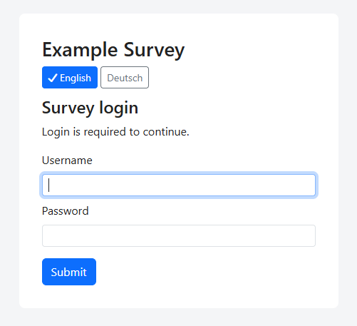
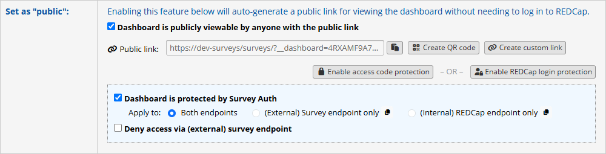

# Survey Auth

[](https://doi.org/10.5281/zenodo.22844808)

Survey Auth is a REDCap External Module that adds session-bound authentication to protected surveys and public dashboards and reports. It supports Custom credentials, REDCap Table authentication, REDCap-configured LDAP, and superuser-configured Other LDAP; scoped, expiring authorization; optional authentication-metadata writes; and optional Multi-Language Management (MLM) survey-login translations.

## Purpose / Use Case

In some cases it is useful to present a data-entry form, public dashboard, or public report without exposing the REDCap user interface, while still identifying the person entering or viewing data. Those users do not need project membership or a REDCap account.

Possible use cases may be incident reports, internal orders/reports or requests for goods or services, etc.

## Effect

When protection is enabled for a survey (public or non-public), public dashboard, or public report, users must authenticate before accessing it. Successful login redirects directly to the protected resource.



Authentication can use project-configured Custom credentials, REDCap's user table, LDAP directories configured in REDCap, and—when enabled by a REDCap superuser—additional project-specific LDAP directories.

## Requirements

**Survey Auth 2.4.0 and later require REDCap 16.0.0 or later.** External Modules Framework version 16 or later is also required. Participant browsers must allow JavaScript.

## Upgrading to 2.4.0

The **LDAP** option now uses REDCap's installed LDAP driver. Review REDCap's LDAP configuration before upgrading because this changes Survey Auth's previous connection defaults and behavior:

- A nonempty `host` takes precedence over `url`. The separate `port` setting is ignored; put a custom port directly in the effective URL. For example, `url="ldap://ldap.example.org"` with no `host` override and `port=636` now uses port 389. Use `ldaps://ldap.example.org:636` for conventional LDAPS.
- The default LDAP protocol changes from v3 to the core driver's v2 default. For StartTLS, explicitly set `version` to 3 and `start_tls` to `true`. The core driver skips StartTLS when `version` is omitted or set to 2, even if `start_tls` is true; Survey Auth follows that behavior. For LDAPS, use `start_tls=false`; PHP must trust the server certificate for either TLS mode. See the [connection settings and examples](#configuration).
- Check that REDCap's LDAP configuration explicitly requests the attributes used by the module's name/email mappings, for example `attributes => ['mail', 'givenName', 'sn']`. The core default requests no extra attributes. Include any other attributes used by your configured mappings.
- Searches, group checks, and driver limitations now follow the installed REDCap driver. See [LDAP driver compatibility](#ldap-driver-compatibility) below, including older base-DN discovery and `try_all` limitations. Credential handling and TLS negotiation follow the installed driver without additional Survey Auth restrictions.

**Other LDAP is unchanged:** it continues to honor the separate port when the URL has no explicit port and defaults to LDAP v3.

Technical authentication and authorization errors are now always recorded in the External Module logs, even when authentication-attempt logging is disabled. Sanitized diagnostics fall back to the PHP error log if module logging fails. Survey, dashboard, and report attempt logs mask usernames longer than three characters, including successful logins; usernames of up to three characters remain visible in full.

## Installation

Install Survey Auth through REDCap's External Modules Manager, either from the Consortium Repository or according to your institution's local module-installation process.

- Go to Control Center > Technical / Developer Tools > External Modules and enable Survey Auth.
- Enable the module for each project that needs survey authentication. Configure at least one authentication method before adding `@SURVEY-AUTH` to a survey instrument or enabling dashboard/report protection. A protected resource with no enabled authentication method rejects every login.

## Configuration

### System-Level Settings

- **Lockout time:** The time, in whole minutes, that a user is denied further login attempts based on the client IP address reported to PHP. It defaults to 5 minutes; set it to 0 to disable lockouts. The project-level Lockout count determines the threshold (default: 3). Failed-attempt counts are shared by client IP across projects using this module and stored in bounded hash buckets. Attempts made while locked out do not extend the deadline, and successful authentication clears that IP's failed-attempt count. When lockouts are enabled, password checks are serialized per IP across projects and sessions so concurrent attempts cannot exceed the configured threshold. A request that cannot obtain the per-IP lock within five seconds fails without checking its password.

### Project-Level Settings

- **Logging:** Technical authentication/authorization errors are always recorded in the External Module logs, independently of this setting. Diagnostics include the failure stage, exception location and trace without arguments, and available LDAP error codes, server diagnostics, warnings, and connection options. Submitted credentials, return codes, and configured bind credentials are redacted; participants receive only the generic error message. If module logging fails, sanitized diagnostics fall back to the PHP error log.

  This setting determines which authentication attempts the module records in the project log. Only REDCap superusers can change this setting. It does not disable REDCap's own page-view or data-change logging.
  - _None:_ No authentication-attempt entries will be produced in the project log.
  - _Failed attempts only:_ Log entries will be produced for failed login attempts only.
  - _Successful attempts:_ Log entries will be produced for successful logins.
  - _All:_ Log entries will be produced for both types of events.

- **Allow writing:** When this is enabled, the module writes the authentication values selected by the `@SURVEY-AUTH` parameters to the survey response before forwarding the user to the survey. For a public survey, it creates a response when those values need to be written; for an existing response, it writes to that response. Without a mapped value or `success` parameter, this setting creates no record. When disabled, the module writes no authentication metadata, although REDCap can still save ordinary survey responses after authorization. Authentication attempts are logged according to the Logging setting independently of Allow writing; survey-authentication log entries include the survey, instance, and outcome. Survey, dashboard, and report attempt logs show only the first three characters of a submitted username followed by `[REDACTED]`, including successful logins, to help correlate support tickets. Usernames of three characters or fewer are shown in full; invalid UTF-8 input is fully masked. Hints are quoted to prevent log-line injection. For longer usernames, the remaining characters and original length are never logged because the username field may accidentally contain a password.

- **Text displayed above username/password fields:** Optionally enter a prompt for the survey user. This is the only participant-facing setting that permits REDCap-supported formatting; unsafe HTML is removed before display. The same filtering applies to its MLM translations. All other labels and messages are displayed as plain text.

- **Username label:** The label to be displayed for the username text box. Defaults to 'Username'.

- **Password label:** The label to be displayed for the password box. Defaults to 'Password'.

- **Submit label:** The label to be displayed on the submit button. Defaults to 'Submit'.

- **Fail message:** A message displayed when authentication fails or is denied. Defaults to 'Invalid username and/or password or access denied.'.

- **Lockout count:** Sets the number of failed login attempts that will trigger a lockout. Set to 0 to disable lockout. Default = 3.

- **Lockout message:** A message displayed after too many failed login attempts. Defaults to 'Too many failed login attempts. Please try again later.'.

- **Technical error message:** A message displayed when a technical error prevents completion of authentication. Defaults to 'A technical error prevented completion of the authentication process. Please notify the system administrator.'.

- **Authentication methods:** Any of the following methods can be used for authentication. Authentication is attempted in this order: Custom > Table > Other LDAP > LDAP, stopping at the first successful method.

  - **Table:** REDCap verifies the username and password against its user table. Suspended accounts are denied.

  - **LDAP:** Uses REDCap's installed LDAP authentication driver and directory configuration, without creating a REDCap staff-login session or requiring a REDCap account. Connection defaults, host/URL precedence, searches, password binds, and group checks follow the installed driver. If REDCap has more than one configured LDAP directory, they are tried in REDCap's configured order. Credential handling, protocol options, and TLS negotiation are delegated without additional Survey Auth restrictions. REDCap's default LDAP protocol is v2; explicitly set `version` to 3 to enable StartTLS. See [LDAP driver compatibility](#ldap-driver-compatibility) for inherited limitations and configuration guidance.

  - **Other LDAP:** Only REDCap superusers can enable or configure this method because its JSON can contain service-account credentials and controls outbound directory connections. Provide any number of LDAP connection info as a JSON array. The order of processing will be as provided in the array. Use the connection and search parameters shown below, adapting the server, service account, base DN, and filters to your directory. The LDAP extension must be available in PHP.

    Example:

    ```JSON
    [
        {
            "url": "ldap://ldap.example.org",
            "port": 389,
            "version": 3,
            "binddn": "cn=redcap,ou=services,dc=example,dc=org",
            "basedn": "dc=example,dc=org",
            "bindpw": "bindpassword",
            "attributes": [],
            "userattr": "samAccountName",
            "userfilter": "(objectCategory=person)",
            "start_tls": true,
            "referrals": false
        }
    ]
    ```

    This Other LDAP example uses LDAP v3 with StartTLS; the server must support it and PHP must trust its certificate. For Other LDAP, v3 is also the default when `version` is omitted. If `start_tls` is true, an incompatible protocol setting or failed TLS negotiation rejects authentication before any bind credentials are sent. Use JSON booleans for `start_tls`.

  - **LDAP connection settings (LDAP and Other LDAP):** For **LDAP**, Survey Auth follows REDCap's installed driver: a nonempty `host` takes precedence over `url`, and the separate `port` setting is ignored. Put a custom port directly in the effective URL; otherwise its scheme selects the default, 389 for `ldap://` or 636 for `ldaps://`.

    REDCap's regular login has long ignored the separate `port` setting when `url` is populated; this behavior is present in REDCap 6.10.0, the earliest version checked. Before REDCap 15.5.5, the separate port was used only when `url` was empty and the connection used `host` instead. Since REDCap 15.5.5, the LDAP driver ignores the separate `port` setting entirely. With `url="ldap://ldap.example.org"`, no `host` override, and `port=636`, both REDCap login and Survey Auth's LDAP option therefore use port 389.

    **Other LDAP** keeps Survey Auth's independent implementation: an explicit port in `url` takes precedence, otherwise the separate `port` setting is honored. Its default `port` is 389, including for `ldaps://` URLs; explicitly set 636 or include `:636` in the URL for conventional LDAPS. In the preceding example, Other LDAP would use port 636 and encounter a protocol mismatch on a conventional LDAPS listener.

    Use matching scheme, port, and TLS settings (the ports below are conventional; use your directory's actual listener ports):

    | Connection | `url` | `port` | `version` | `start_tls` | Encryption |
    | --- | --- | --- | --- | --- | --- |
    | LDAP | `ldap://ldap.example.org:389` | 389 | 3 | `false` | No TLS encryption |
    | LDAP with StartTLS | `ldap://ldap.example.org:389` | 389 | 3 | `true` | TLS negotiated before binding |
    | LDAPS | `ldaps://ldap.example.org:636` | 636 | 3 | `false` | TLS established immediately on connection |

    Explicit URL ports make these examples work for both LDAP methods. The separate `port` column is relevant only to Other LDAP when the URL has no explicit port.

    Setting `port=636` alone does not enable TLS. `ldap://` on a conventional LDAPS listener at port 636 causes a protocol mismatch; StartTLS also uses the LDAP listener, normally on port 389. For StartTLS and LDAPS, PHP must trust the server certificate and the hostname or IP address in the URL must match it. See [OpenLDAP's TLS documentation](https://www.openldap.org/faq/data/cache/185.html).

  - **LDAP Attribute mappings:** Available when either LDAP method is enabled. Enter comma-separated attribute names for email, full name, first name, and last name. Email defaults to `email,mail`, first name to `givenName`, last name to `sn`, and full name has no default. The module uses a full-name value when present; otherwise it combines first and last name.

  - **Fall back to retrieving user information from REDCap's user table when no values are obtained from LDAP attributes:** After successful LDAP authentication, any missing email or full name is filled from the REDCap user table for the submitted username. Values already obtained from LDAP are retained. This does not authenticate against the REDCap table or create a REDCap account.

  - **Custom:** When selected, custom credentials can be entered into a text box. Type one nonempty username/password pair per line, with the first colon as the separator (for example, `UserXY:secret123`; later colons remain part of the password). Usernames are case-insensitive; passwords are case-sensitive. Malformed or blank lines are ignored.

- **Use Allowlist:** When checked, a list of usernames (one username per line) can be entered. Only users in this list will be able to authenticate successfully. Matching is case-insensitive; an enabled empty allowlist denies everyone.

- **Survey Auth login translations** (project link): This link is shown when the project has at least one survey with `@SURVEY-AUTH`, MLM is active for the project, and at least one MLM language is project-active. It lets users with project Design rights translate the Survey Auth survey-login text for project-active languages. At runtime, a language is available only when it is also active for that particular protected survey; survey titles and custom-logo alternative text come from MLM's own survey metadata, and Returning?/Return Code/help use MLM's core UI translations. Dashboard and report login pages are not translated by this feature.

- **Public Dashboard Access Denied Message:** Allows a custom plain-text message when a public dashboard is configured to deny access from the external survey endpoint. Failed dashboard logins use the Fail message instead.

- **Public Report Access Denied Message:** Allows a custom plain-text message when a public report is configured to deny access from the external survey endpoint. Failed report logins use the Fail message instead.

### LDAP driver compatibility

The **LDAP** option inherits the behavior of the installed REDCap driver. The following observations cover both driver revisions found in REDCap 16.0.0 through 17.5.11:

- **Set an explicit search base on older versions:** In REDCap 16.0.0 through 17.5.5 with PHP 8.1 or later, automatic base-DN discovery fails. Set `basedn` explicitly in REDCap's LDAP configuration. These versions also repeat connection setup during authentication and group checks. REDCap 17.5.6 recognizes PHP's LDAP connection objects and supports automatic base-DN discovery.
- **Use a search that identifies one account:** In both inspected revisions, `try_all=true` fails to reach a later matching account after the first account rejects the password. Configure `userattr` and `userfilter` to identify a unique account; do not rely on retrying multiple matching entries.
- **Check group-search permissions:** Group checks follow the installed driver. From REDCap 17.5.6, the driver explicitly restores the configured search identity (service account or anonymous bind) before searching for membership. That identity must have permission to read the required group information.

Survey Auth delegates credential handling and TLS decisions to the installed core driver. In the inspected revisions, core strips NUL bytes from passwords before binding and skips StartTLS when the protocol version is omitted or set to 2, even if `start_tls=true`. To enable StartTLS, set `version=3` and `start_tls=true` in REDCap's LDAP configuration. Survey Auth adds no credential or TLS rejection rules to this path. It retains sanitized diagnostics and survey-session isolation.

Only a successful core authentication result can publish mapped name/email attributes; both core attribute formats, `AUTH` and `LDAP`, are supported. Optional user-table fallback runs only after successful LDAP authentication.

These limitations apply to **LDAP**. **Other LDAP** retains its independent implementation, including its own base-DN discovery and iteration over matching entries.

Compatibility checks used both core driver revisions with disposable OpenLDAP and PHP 8.2, including StartTLS, LDAPS, certificate rejection, groups, attribute mapping, and session isolation. They do not establish compatibility with every PHP version, Active Directory policy, deployment certificate, or site's executable LDAP configuration; verify the configuration used by your installation.

### @SURVEY-AUTH Action Tag

To enable authentication for a survey, use the **@SURVEY-AUTH** action tag on any field of the survey instrument. Parameters are optional, and there must be at most one such tag per instrument.

```ActionTag
@SURVEY-AUTH(success=value, username=fieldname, email=fieldname, fullname=fieldname, timestamp=fieldname)
```

When _username_, _email_, _fullname_, or _timestamp_ are defined, the corresponding data will be inserted into the specified fields when Allow writing is enabled (timestamp format will match the datetime format of the target field; time-only fields are not supported; the default date format is YMD).

When a value for _success_ is defined, the field with the action tag will be set to this value when Allow writing is enabled; no additional mapping is required. Use @READONLY/@READONLY-SURVEY or @HIDDEN-SURVEY to keep participants from editing the displayed authentication fields. With Allow writing enabled, the module also discards survey-request edits to the authentication fields it populated, including attempts to blank them. This preserves the values already saved at login; ordinary survey answers and staff data-entry edits are unaffected.

### URL prefill

REDCap URL prefill parameters are supported for a protected survey's first page, including when the participant must first sign in. When the participant opens the survey link, Survey Auth retains only values for real first-page fields and valid checkbox options, then restores them after login. It excludes calculated fields, fields that Survey Auth writes through `@SURVEY-AUTH`, unknown fields, and REDCap control parameters. Save & Return, Start over, answer submissions, and file requests do not retain prefill values.

The values remain participant-supplied prefill; they do not grant access or override authentication metadata. URL prefill is therefore appropriate only for data that is suitable for a survey URL under your institution's privacy and logging practices.

### Resuming a saved public response

When a protected public survey enables REDCap's Save & Return feature, its login dialog includes an optional **Returning?** return-code field. Enter the code together with the Survey Auth credentials to continue the saved response. Survey Auth validates the code, writes authentication metadata to that existing response when **Allow writing** is enabled, and continues the response without prompting for the code again. The code is not added to the survey URL; selecting it also discards any pending URL prefill. Private survey links continue to use REDCap's native return-code and Start over page.

### Combining **@SURVEY-AUTH** with **@IF**

The **@SURVEY-AUTH** action tag can be used inside **@IF** action tags. Note that in public surveys, at the time of evaluation, the record does not exist yet, and thus any logic should be restricted to record-independent elements, such as e.g. the `[arm-number]`, `[arm-label]` or the aggregate smart variables.


## Public Dashboards and Reports

Survey Auth options appear in a separate blue panel when editing an existing public Project Dashboard or an existing Report. Report protection applies when the report is public. Enable the protection switch to require login.

In REDCap installations that use a separate endpoint for surveys, additional options are available:

- The option to require login for both endpoints or only for the (external) survey endpoint or the (internal) REDCap endpoint.
- The option to deny access to public dashboards/reports when accessed via the (external) survey endpoint. The message that is displayed in such a case can be set in the module's project level configuration.

The copy icon beside each endpoint option copies that endpoint’s public report/dashboard link, including its configured base path. The button briefly turns green after a successful copy. Copying a link does not change protection settings or share authorization.



Endpoint selection uses the configured scheme, hostname, port, and base path. When a reverse proxy is used, configure PHP and REDCap with the canonical public server name, port, and scheme. Internal and external URLs can share a hostname if their base paths differ; the more specific matching path takes precedence. Requests matching neither configured endpoint are denied. Denying external access takes precedence over login protection, including for users who already authenticated.

Dashboard copies inherit the source dashboard's SurveyAuth settings. Copies remain private until those settings are saved, and become public only if REDCap's publication rules permit it. REDCap copies reports as non-public; review protection when making a copied report public.

## Authentication sessions

Authorization is stored in the REDCap survey session for the browser making the request. Sharing a survey, dashboard, or report URL does not share authorization.

- Use one active survey tab at a time. Multiple login tabs can authenticate independently without refreshing after another tab opens. Completing a survey with final Submit makes REDCap destroy the shared survey session, so other tabs must sign in again; unsaved answers are not automatically restored.
- Login forms expire after 10 minutes. Reopen the resource to obtain a fresh form.
- Authorization expires after 30 minutes without authorized activity or 8 hours after login, whichever comes first. REDCap session expiry or loss of the session cookie can end access earlier.
- With **Allow writing** enabled, **Start over** restores the exact authentication values originally written by the module (including the original timestamp), while leaving survey answers cleared. Sessions created before this feature ask for login again before resetting.
- On an initial survey GET, validated URL-prefill values for ordinary first-page fields remain available after login. They are retained only in the pending login context and are not a way to preserve POSTed answers or uploads.
- Survey authorization is scoped to the survey response and repeat instance. Public starts are kept separate; a public Save & Return survey accepts its return code in the login dialog and still requires REDCap's return-code validation plus SurveyAuth authorization. Private links retain REDCap's native return-code page.
- Dashboard and report authorization is scoped to the individual resource and endpoint. Logging into one does not authorize another.
- Protection-setting changes invalidate existing authorization. Table-authenticated sessions also recheck account suspension and password changes. LDAP credentials are checked at login, not on each subsequent request.

## Retired settings

The former **Success message** and **Continue label** settings have been removed because successful login redirects immediately. During an upgrade, their saved values are removed and cannot be restored by rolling back the module.

A legacy token setting is converted to **Allow writing** during an upgrade when no explicit Allow writing value is already saved. The legacy token is then removed; rolling back does not restore it.

## Release History

See [CHANGELOG.md](CHANGELOG.md) for version history and notable changes.

## How to cite this work

Please use the citation generated from [CITATION.cff](CITATION.cff). On [GitHub](https://github.com/grezniczek/redcap_survey_auth), select **Cite this repository** for ready-to-use citation formats.

---

## AI assistance

Development of this project has made extensive use of AI assistance. AI tools, primarily ChatGPT by OpenAI, have been used throughout the development process, including for discussion and refinement of design and architecture, implementation and refactoring of code, debugging and review, and preparation and revision of documentation.

The extent and nature of this assistance vary across the project and are not attributed to individual commits. AI-generated suggestions and contributions are reviewed, adapted, and integrated as part of the normal development process.

Responsibility for the design, implementation, maintenance, and released software remains entirely with the project maintainer.
