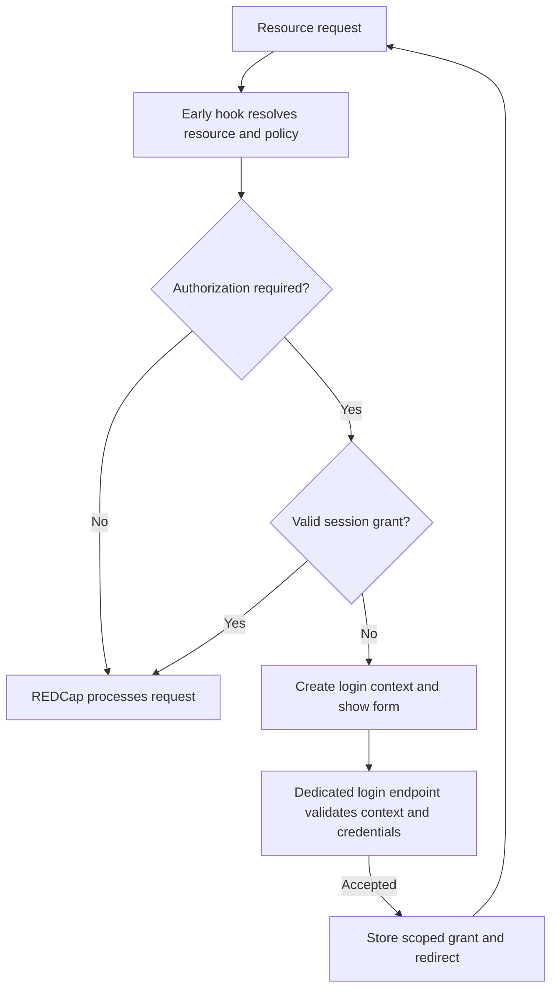

# Implementation guide

This guide describes the current implementation of Survey Auth. For configuration and participant-visible behavior, see the [README](../README.md). For changes and verification, see the [maintenance guide](maintenance.md).

## Responsibilities and source map

Survey Auth decides whether a browser session may access a configured survey, public dashboard, or public report. REDCap continues to own survey processing, response storage, return codes, and native file handling. Authentication against a directory does not make the participant a REDCap project user.

| Source | Responsibility |
| --- | --- |
| [SurveyAuthExternalModule.php](../SurveyAuthExternalModule.php) | Hook dispatch, resource settings, dashboard copying, authentication backends, metadata writes, lockout storage, migrations |
| [SurveySessionAuth.php](../classes/SurveySessionAuth.php) | Survey identity resolution, request authorization, login contexts, session grants, continuation and completion |
| [PublicResourceAuth.php](../classes/PublicResourceAuth.php) | Dashboard/report identity, endpoint policy, scoped authorization and login completion |
| [SurveyAuthSettings.php](../classes/SurveyAuthSettings.php) | Configuration defaults and normalized authentication settings |
| [SurveyAuthInfo.php](../classes/SurveyAuthInfo.php) | Action-tag parameters and metadata mappings |
| [SurveyAuthMlm.php](../classes/SurveyAuthMlm.php) | Survey-login translations, MLM language eligibility and bounded translation storage; see the [companion integration](../MLM_Companion_Integration.md) |
| [survey-login.php](../survey-login.php) | Compatibility endpoint for previously opened native login forms |
| [session-login.php](../html/session-login.php), [survey-login.js](../js/survey-login.js) | Shared AJAX login form, errors and redirect |
| [config.json](../config.json) | Framework version, endpoint registration, configuration UI and action tag |

## Request and login flow

Explicit access denial and invalid or ambiguous contexts stop the request rather than proceeding through the diagram's unprotected branch.

`redcap_every_page_before_render` checks authorization before ordinary survey submission processing. It also handles public-resource requests and supported direct file routes. Its name alone is not evidence of its position relative to core writes: that ordering is an integration dependency.

Core page-view logging precedes the early hook. The login form uses `JSMO.ajax('survey-login', payload)` through the framework's `surveys/?__passthru=ExternalModules` endpoint, which core excludes from page-view POST logging. The module's early gate lets its own framework AJAX requests reach framework dispatch; ordinary survey processing and other modules' requests retain their existing authorization checks. The framework validates CSRF, encrypted request context and the registered no-auth action before calling the module. The module additionally validates its session-bound login context/CSRF and matching project, then re-resolves resource identity and policy before issuing a grant. Errors return as data; failed credentials rotate session CSRF for the next attempt. Success returns a same-origin redirect. Neither core nor web-server configuration changes are required.

Login uses the participant's REDCap survey session. Session initialization uses REDCap’s survey cookie-name helper when available, falling back to the legacy `survey` name. It preserves active sessions only when their exact names match that helper or the recent survey entry-point naming scheme, including root-path and separate-endpoint differences; it does not transfer a staff session into a participant session. Redirects use validated paths on the participant's current origin. Login requires JavaScript. Inputs have no native submission names, and the submit button stays disabled until initialization, so a failed script cannot submit credentials through ordinary survey processing. A no-JavaScript notice explains how to continue. Passwords are serialized once and cleared from the object retained by the framework AJAX queue, whose transport-error logging may otherwise expose payload properties. Each login context retains the framework CSRF token embedded in that tab. Before framework AJAX dispatch, the module may use that token as the request-local cookie value only after matching both it and the independent login CSRF against the live context in the same survey session. This handles the framework's browser-wide cookie rotation without changing browser cookies, framework code, or signed-request verification. Expired/consumed contexts and tokens from another session cannot use this path.

## Session state and identity

The module stores `logins` and `grants` under `redcap_survey_auth_v2` in the REDCap survey session. A login context contains navigation and authorization scope, a policy revision, CSRF value, expiry and, for an initial survey GET, a bounded allowlist of URL-prefill values. Policy revisions include an implementation version so security upgrades can invalidate previously issued contexts and grants. On successful login, the native session ID is regenerated with deletion of the old session before a new grant is issued; failure to rotate denies access. Other pending contexts and native session data remain in the new session. Survey grants also retain the exact authentication field values successfully written at login, for restoration after Start over. It does not retain the password or submitted survey answers/uploads.

| State | Lifetime |
| --- | --- |
| Pending login context | 10 minutes |
| Return-entry grant awaiting response selection | 10 minutes |
| Ordinary resource/survey grant | 30 minutes idle, at most 8 hours from login |

REDCap session expiry or loss of the session cookie can end authorization earlier. The state is bounded to 16 pending contexts and 32 grants. These are implementation limits, not configuration settings.

Survey identity is resolved from REDCap's survey, participant, and response records. A continuation may use a response hash validated by core; Save & Return uses core return-code resolution. A public initial login context offers a return-code input only when Save & Return is enabled. When supplied, the code is validated before authentication resolves a response scope, and is never stored in the context or redirect. Authentication metadata is then written against that resolved response, and the resulting grant uses its policy revision. Only for this public-link, validated-code case, the browser sends the code once in a same-origin POST to REDCap, which establishes REDCap's normal continuation state without rendering its return-code page. Private survey links retain REDCap's native return-code page. Posted record IDs are not an authorization source. Scope distinguishes project, survey, event, instrument, response/record and repeat instance.

On an initial ordinary GET request, the pending login context may retain URL-prefill values for a maximum of 128 real first-page fields, at most 4 KiB per value and 16 KiB in total. It derives the first-page field set from the survey's paging metadata, accepts valid checkbox options, and excludes calculated fields and any field mapped by the active `@SURVEY-AUTH` tag when Allow writing is enabled. Values are restored only by an RFC3986-encoded post-login redirect. The module never forwards arbitrary query parameters and does not retain prefill on Save & Return, Start over, POST or file requests; choosing a return code discards pending prefill before the response is resumed.

Before a public response exists, a session-bound flow identifier separates starts in different tabs. The identifier has no authority without its matching session grant. `redcap_survey_page_top` adds navigation fields only; it is not the authorization gate.

After an authorized save, `redcap_save_record` binds the confirmed response to a continuation grant. It consumes a request-local authorization decision and checks the hook's scope. `redcap_survey_complete` removes the matching response grant. A grant for one response or repeat instance is not project-wide authorization.

REDCap's Start over clears data directly without invoking the ordinary save hook. The early gate authorizes the reset and binds its response ID to the validated response hash. At `redcap_survey_page_top`, the module verifies the same record/event/instrument/instance and confirms that core cleared the response status, then restores only the authentication values retained in the grant through the same metadata writer used at login. It reloads the response without the reset parameter because core already built the form with cleared values. Original username, directory attributes and timestamp are preserved; no new authentication event or record is created. Allow writing off prevents restoration. A restoration failure stops rendering, revokes the grant and requests reauthentication. Older grants without a value snapshot require reauthentication before the reset can run.

REDCap's completion page destroys the entire native survey session after the completion hook. Consequently, completing a survey in one tab also ends authorization in other tabs sharing that session. The module does not recreate authorization after core destroys the session; another protected tab must reauthenticate, and an in-flight answer submission is blocked without replay. Saving an intermediate page does not invoke this core completion cleanup.

Policy revisions include loaded settings and, for surveys, the data dictionary. Missing, empty, malformed, or otherwise unusable survey metadata fails closed before protection is evaluated; it cannot be treated as an unprotected instrument. Changes can require fresh login. Table-authenticated grants additionally check account suspension and a revision derived from password/salt storage. LDAP credentials are checked at login, not continuously against the directory.

If authorization expires during a POST, the module blocks the write and reports that the submission was not saved. It does not automatically preserve or replay answers or uploads. Reauthentication reopens the survey; browser recovery of unsaved input is not guaranteed.

## Public dashboards and reports

The module resolves a public resource by project, type and public hash. Its grant includes resource ID, hash and endpoint. Logging into a dashboard does not authorize a report or another dashboard.

Endpoint classification compares configured scheme, hostname, port and base-directory path. The request origin uses the server-controlled `SERVER_NAME` and `SERVER_PORT`, not the client-controlled `Host` header; reverse proxies must supply PHP with the canonical public values. The most specific matching directory wins when bases overlap. An unmatched request fails closed. Explicit external-access denial takes precedence over an existing login grant. Denial messages are rendered as escaped plain text.

Protection settings are stored per resource ID. The dashboard copy handler uses core's copy method with a private source snapshot, writes the three destination protection settings, then restores public visibility only when core publication rules permit it. This ordering matters because the core copy method manages its own transaction. A failed settings copy must leave the destination private. Staff design rights, core CSRF handling, and core-compatible response output are retained.

Core report copies are non-public. Protection must be reviewed when a copied report is subsequently published.

## Authentication, writes and logs

Both authentication flows use one dispatcher: Custom, Table, Other LDAP, then REDCap LDAP. Processing stops at the first accepted backend. Each attempt owns its result; unaccepted directories must not contribute identity attributes to another method's success.

Custom credentials require nonempty usernames and passwords, preserve colons in passwords, use exact password comparison and normalize usernames. Table authentication checks account availability and suspension before password verification. LDAP supports configured search scopes, group restrictions, attribute mapping and optional fallback for missing email/full name. Attribute names are matched case-insensitively and submitted UTF-8 usernames are preserved. LDAP defaults to protocol v3, validates explicit protocol/TLS settings and checks that the protocol option was applied. Requested StartTLS must succeed before any service or user bind; version 2 with StartTLS is rejected. REDCap user-table fallback supplies missing attributes only after LDAP authentication succeeds. Other LDAP activation and connection JSON are superuser-only project settings because they can contain service credentials and determine outbound connections.

Participant-facing text is context encoded at output. The only HTML-capable setting, login instructions and its MLM translations, passes through REDCap's `filter_tags()` allowlist before raw rendering; all other login values are escaped as text. The MLM companion accepts only known item keys and valid versioned entries, limits each value, and applies a shared 2 MiB bound to both reads and writes.

With Allow writing enabled, action-tag mappings may write authentication metadata. Before native survey processing, the early gate removes participant-supplied values for the fields retained in the authenticated snapshot. It handles scalar/array values, native checkbox and repeat encodings, prefill inputs, named upload inputs, and the `empty-required-field` list that core expands into blank values. Existing saved values are preserved rather than reinserted as form input, avoiding date/checkbox reinterpretation. Old writing-enabled grants without a snapshot require fresh login. This guard does not run on ordinary staff data-entry requests or when writing is disabled. A success-only assignment is sufficient; the record ID is not a writable mapping target. Save results must have no errors, and new records must have a returned ID before completion produces a destination. Repeating events and forms use the appropriate REDCap data structure. Return-entry authentication defers these writes until the response is known.

The Logging setting selects successful and/or failed authentication events. Survey entries include the submitted username, survey and instance, with project/event/record context. A submitted identity in a failure entry is not a verified identity. Passwords are never intentional log fields. REDCap's own logging is independent of the module's Logging setting.

Lockout counters are shared by `REMOTE_ADDR` across projects; each project supplies its threshold. A system setting supplies the duration. Checks do not extend the deadline, and successful authentication clears that address's counter. SHA-256 assigns each address to one of 16 system-setting buckets. Only that bucket is loaded from the primary connection. Expired, malformed or misplaced entries are ignored when read and removed on the bucket's next locked mutation. Each bucket is capped at 1,024 addresses and 256 KiB.

When system lockout time is positive, a per-IP MySQL advisory lock covers threshold checking, password verification and failure/success bookkeeping across sessions and projects. Acquisition waits at most five seconds; a timeout rejects the request before password verification. The lock is released even on backend or storage exceptions. A separate, short per-bucket lock covers that bucket's JSON read/modify/write operation, so slow authentication backends and unrelated buckets do not share this module lock. The EM Framework may still briefly serialize the final system-setting writes internally. Both module locks and the protected storage reads use the primary connection. Framework setting helpers perform writes; direct core queries are used where explicit primary-connection control is required.

## Proposed REDCap LDAP adapter: compatibility check (2026-11-12)

This investigation supports a REDCap 16.0.0 minimum for a future adapter for the **LDAP** option. It does not change runtime authentication, compatibility metadata, or **Other LDAP**. The LDAP behavior described above remains the current implementation.

### Scope and evidence

The local Git inventory contains 135 numeric REDCap 16.x/17.x tags. Across those tags, `Libraries/PEAR/Auth/Container/LDAP.php` has two revisions:

| Tagged versions | LDAP driver blob | Relevant difference |
| --- | --- | --- |
| 129 tags, from 16.0.0 through 17.5.5 | `9a4578d5aaab753f9ef253640f986c59382f0edc` | Connection validity checks recognize resources, not PHP 8.1+ LDAP connection objects |
| Six tags, 17.5.6 through 17.5.11 | `b266fcde58c8da58985f4c3701c13c3cf57b2246` | Recognizes connection objects, resets disconnected handles, explicitly restores the search identity for group checks, adds an authenticated profile snapshot, and updates filter escaping |

The accompanying `Auth.php`, `Auth/Container.php`, and `PEAR.php` files are identical across the inventoried tags. Both LDAP revisions expose the same constructor, `fetchData()`, `_auth_obj`, and logging interface needed by an adapter.

Real LDAP checks used unmodified tagged drivers from 16.0.0, 16.0.61, 17.0.0, 17.3.0, 17.5.5, 17.5.6, and 17.5.11. Each ran in a separate PHP process against disposable OpenLDAP with synthetic users, StartTLS, LDAPS, and a trusted test certificate. The container used PHP 8.2.35 and published no ports. Twenty cases per tag and two additional untrusted-certificate cases passed 533 assertions about the observed behavior. The existing module's real LDAP integration checks also passed. Tagged source was exported only to temporary files; no REDCap source was copied into this repository.

| Check | Observation |
| --- | --- |
| Session isolation | Direct driver construction with an in-memory `_auth_obj` supporting `log()` and `setAuthData()` leaves session, POST, and cookie data unchanged; no staff `Auth` object is needed |
| Connection settings | Both revisions ignore the separate port, honor explicit URL ports, prefer a nonempty `host` over `url`, and support StartTLS and LDAPS |
| Credentials and groups | Correct credentials, UTF-8 usernames, literal filter metacharacters, and group members authenticate; wrong/empty passwords, wildcard input, and non-members are denied |
| Attributes | Both `AUTH` and `LDAP` attribute formats provide mapped name/email data; attributes can also be staged before a failed password or group check |
| Operational errors | Failed service binds return `PEAR_Error` objects; LDAP error codes can be captured through the logging callback before disconnect |
| Certificate rejection | An untrusted certificate prevents StartTLS completion and any service bind; the callback captures the LDAP diagnostic before cleanup |

These are driver integration checks, not a complete REDCap staff-login or browser test. They do not certify Active Directory, deployment certificates, site-specific executable `ldap_config.php` logic, or other PHP versions.

### Differences that constrain the adapter

REDCap's default protocol version is **2**, whereas Survey Auth currently defaults to **3**. With `start_tls=true` and an omitted or explicit version 2, the core driver skips StartTLS and attempts the service bind. The fixture's server rejects LDAP v2, but a server accepting it could accept that unencrypted bind. The adapter should reject this incompatible configuration before connecting, preserving Survey Auth's existing encryption requirement.

The core driver strips NUL bytes from passwords. A synthetic password containing an inserted NUL authenticated as the password with that byte removed. Reject NUL-containing credentials before delegation so the module does not introduce password normalization. This and the TLS guard are explicit safety exceptions to literal core parity.

Before 17.5.6, PHP LDAP connection objects cause repeated connection setup: the normal successful case makes two connections and a group check makes three. Empty-base-DN discovery fails in that driver revision but succeeds from 17.5.6. Do not override connection validity merely as a cleanup convenience: doing so also changes connection reuse and group-search identity. A wrapper can release a remaining connection in `finally` without changing core's authentication sequence.

In both revisions, a `try_all=true` fixture with two matching entries fails to reach a second entry whose password is valid after the first rejects it. Authenticating that second entry directly succeeds. Source inspection shows the search result is freed before the loop advances. Reusing the driver inherits this core limitation; a separate core fix would be needed to change it consistently for staff and survey login.

The `redcap_ldap_profile` snapshot exists only from 17.5.6 and contains a fixed subset of attributes. It cannot be the adapter's universal source for Survey Auth's configurable mappings. The temporary auth-data collector must support both output formats and expose only the mapped identity fields after strict success. Never log or retain the complete attribute response: depending on directory permissions and requested attributes, it can contain credentials or unrelated sensitive attributes.

### Recommended implementation

1. Add a small adapter around the installed `Auth_Container_LDAP`. Construct a fresh driver and in-memory auth-data collector for each configured REDCap directory, call `fetchData()` directly, and accept **only** the literal result `true`. Convert `PEAR_Error` and thrown exceptions into sanitized technical diagnostics; an error object must never be treated as a successful truthy result. Avoid constructing `Auth` or invoking REDCap's staff-login handler, which initializes staff authentication session state.
2. Pass REDCap's configuration through without Survey Auth's connection defaults or URI builder. Preserve installed-core connection, search, bind, group, and `try_all` semantics, subject to the explicit credential/TLS guards above. Keep module directory order, backend precedence, survey lockouts, sessions, and grant handling. Publish mapped name/email values and apply the existing optional table-attribute fallback only after acceptance.
3. Capture warnings, stages, and LDAP diagnostics while handles remain usable, then use the existing credential-redaction and technical-error logging helpers. Do not forward the driver's raw debug stream. Release temporary attributes and remaining LDAP connections on every outcome, preserving the original failure if cleanup itself fails.
4. Route only `authenticateLDAP()` through the adapter. Keep `authenticateOtherLDAP()` and its existing `doLDAPauth()` path unchanged. In that implementation slice, declare `compatibility.redcap-version-min` as `16.0.0`, update the user-facing distinction between the two LDAP modes, and retain regression coverage for both driver revisions and the unchanged Other LDAP path.

The adapter is feasible without REDCap-version branches for the two inspected driver revisions. The compatibility contract should cover the installed core's directory behavior while explicitly retaining the module's input/TLS safeguards and survey authorization boundary. Do not promise identity with every aspect of staff login or silently patch the inherited driver limitations inside Survey Auth.

## Settings lifecycle

System enable/version-change and project enable hooks run state-based, repeatable migrations. System cleanup discovers retained project settings even where the module is disabled. Project enable also handles values imported or restored later. System enable redistributes valid, unexpired counters from the released single `surveyauth_lockouts` setting into hash buckets. Bucket writes complete before the legacy setting is removed, so a partial migration can be retried.

Retired forwarding settings are removed through framework helpers. The older token-to-Allow writing transition preserves an explicit writing choice. Migration decisions depend on stored state, not numeric version arithmetic. See the README's retired-settings section for rollback implications.
